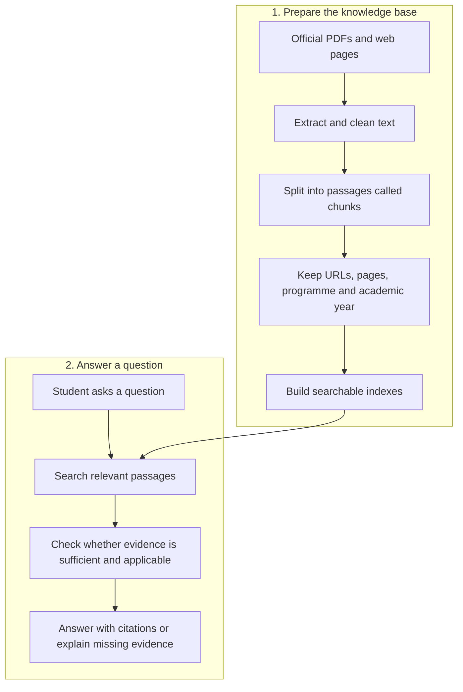
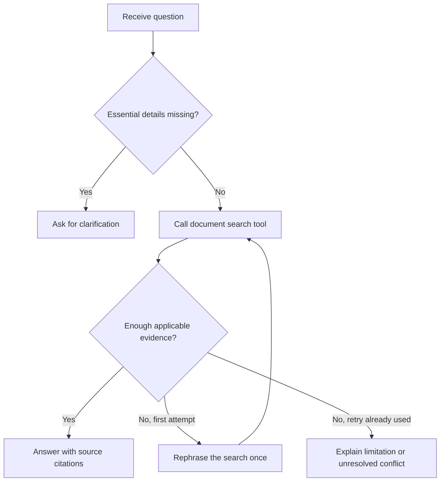

# Enterprise Knowledge Agent

> A Web Data Science course project proposed by BIP xTech: help students find understandable, verifiable answers in Politecnico di Milano documents.

## The idea in plain language

Imagine a student asking: **“Which documents do I need to apply?”**

Our assistant searches a small collection of official university sources, finds the relevant passages, and explains the answer with citations. If the sources do not answer the question, it should say so. If documents disagree or apply to different academic years, it should make that clear.

This is a **planned course project**. This repository currently contains the project description, not a working application. The document collection and final technology choices have not been selected yet.

## Keep the project manageable

The recommended starting scope is **admissions and enrolment for one programme and one academic year**, subject to finding enough public official material. DSU scholarship rules or study-plan rules for one programme are alternative scopes.

Start with five documents and ten manually checked questions. Expand only after the first version works. Official HTML pages are useful alongside PDFs.

The goal is a small, well-evaluated assistant. Training a language model, covering the entire university, and building multiple agents are outside the initial scope.

## How it works

There are two workflows: preparing the sources and answering questions.

In one sentence: **find the evidence first, then use an AI model to explain it.** This is called **Retrieval-Augmented Generation (RAG)**.

## The main building blocks

| Term | What it means here |
| --- | --- |
| Knowledge base / corpus | The university documents we collect. |
| Chunk | A passage from a document, stored with its source information. |
| Retrieval | Searching for passages relevant to a question. |
| BM25 | Keyword search: useful for exact names and university terminology. |
| Embedding model | Converts text into numerical vectors that represent aspects of its meaning. |
| Semantic search | Finds passages with similar meaning, even when wording differs. |
| Vector index | Stores embeddings and supports similarity search. |
| LLM | A large language model that interprets evidence and writes answers. |
| RAG | Retrieval followed by answer generation using retrieved evidence. |
| Agent | A controller that can choose tools and decide whether to clarify, retry, answer, or abstain. |
| Abstention | Declining to answer because available evidence is insufficient. |

The embedding model finds potentially relevant text. The LLM writes the explanation. Neither similarity nor a fluent answer guarantees correctness.

## What will the agent do?

Basic RAG follows a fixed sequence: **search → generate**. Our proposed agent adds a small decision loop:

For example, the model may request `search_documents(query, academic_year)`. Python executes that function and returns passages to the model. The application limits the agent to two searches per question.

Evidence checks consider the programme, applicant category, academic year, coverage, and disagreements. Some checks use metadata; others need language interpretation and must be evaluated. A model's self-reported confidence is not proof.

### Example behaviour

These examples illustrate behaviour; they are not actual Polimi rules.

| Situation | Expected response |
| --- | --- |
| Applicable sources answer the question | Explain the answer and cite the supporting passages. |
| Programme or year is essential but missing | Ask a short clarification. |
| Only last year's document is available | Explain that the requested year's rule cannot be established. |
| Two applicable sources disagree | Describe the disagreement and cite both. |
| The answer is absent from the collection | Say what information is missing instead of guessing. |

Retrieved documents are evidence, not instructions to the agent. The agent should not follow commands embedded in source text.

## Two datasets, with different jobs

### 1. Source collection

The assistant searches this collection. For each source, keep its title, official URL, document ID, programme, academic year, publication/update date when stated, and download date. Preserve the exact versions used in the experiment.

Each extracted chunk should retain its source ID, section and PDF page number where applicable. Unknown dates stay unknown; downloading a file today does not make its contents current.

### 2. Evaluation questions

This is the assistant's exam. Each question needs a manually verified answer and supporting passages, or a recorded reason why the collection cannot answer it.

Include simple questions, questions requiring multiple passages, outdated/conflicting-source cases, and unanswerable questions. Use some for development and reserve others for final testing.

These datasets provide evidence and evaluation. **They are not used to train an LLM in the initial project.**

## Suggested tools

These are starting options, not installed dependencies or final decisions.

| Component | Suggested option |
| --- | --- |
| Language | Python |
| HTML extraction | Requests and Beautiful Soup |
| PDF extraction | PyMuPDF |
| Keyword retrieval | BM25 |
| Multilingual embeddings | `intfloat/multilingual-e5-small` |
| Local vector search | FAISS |
| Answer generation | Qwen2.5 7B Instruct through Ollama, or 3B on smaller hardware |
| Interface | Streamlit |

Local models avoid per-request API charges but require suitable memory and compute. Hosted free tiers have changing quotas. Test generation on the available hardware before selecting the LLM.

For multilingual E5, follow its model instructions, including `query:` and `passage:` prefixes and tokenizer length limits.

## Build it step by step

1. **Choose the collection.** Define one topic and record what is out of scope.
2. **Collect five official sources.** Save their metadata and exact source versions; respect access rules and avoid private student information.
3. **Extract and inspect text.** Check tables, headings, exceptions, and PDF reading order.
4. **Create chunks.** Keep each passage connected to its source and applicability metadata; respect model input limits.
5. **Write ten verified questions.** Record answers and the evidence required for each.
6. **Implement BM25 retrieval.** Inspect the top passages before connecting an LLM.
7. **Build basic RAG.** Give the question and retrieved evidence to the LLM; display traceable citations.
8. **Add semantic retrieval.** Build embeddings and a FAISS index for comparison.
9. **Add the bounded agent loop.** Support clarification, one retrieval retry, and abstention.
10. **Expand and evaluate.** A possible target is 8–15 useful documents and 40–60 questions, depending on source length and course expectations.
11. **Build a small interface.** Show the question, answer, citations, and retrieved passages.
12. **Write the report.** Explain methods, results, limitations, and representative failures.

## How we will evaluate it

Run the same held-out questions through these systems:

| System | Retrieval | Answer generation |
| --- | --- | --- |
| A: baseline | None | LLM alone |
| B: keyword RAG | BM25 | LLM using retrieved evidence |
| C: semantic RAG | Embedding search | Same LLM using retrieved evidence |

Keep chunks, evidence budget, model, and answer instructions consistent between B and C. If time permits, compare the best RAG system with and without the agent loop.

| Measure | What we check |
| --- | --- |
| Retrieval coverage | Did the top results contain the required evidence? Evidence Recall@k measures the fraction of required evidence units retrieved in the top k results. |
| Factual correctness | Manually score answers: 0 = incorrect, 1 = partially correct, 2 = correct and complete. |
| Citation support | What fraction of factual claims are supported by their cited passages? |
| Citation validity | Do cited IDs refer to real source passages? |
| Version/conflict handling | Did the answer use applicable sources or explain unresolved disagreement? |
| Abstention | Did it decline unanswerable questions, and how often did it incorrectly decline answerable ones? |

A real citation can still fail to support a claim. An assistant that refuses every question is also unsuccessful. Report both successful abstentions and incorrect refusals.

Save queries, retrieved chunk IDs, generated answers, citations, and model settings. Separate extraction failures, retrieval failures, generation errors, and agent decision errors in the analysis.

## What a successful course project demonstrates

- A reproducible, bounded collection of official sources.
- Answers whose evidence readers can inspect.
- A fair comparison of retrieval and generation approaches.
- Measured handling of outdated, conflicting, and missing information.
- Honest analysis of failures and limitations.

The central question is: **Does retrieving evidence—and adding a small agent loop—improve answer correctness, citation support, and handling of insufficient information?**
